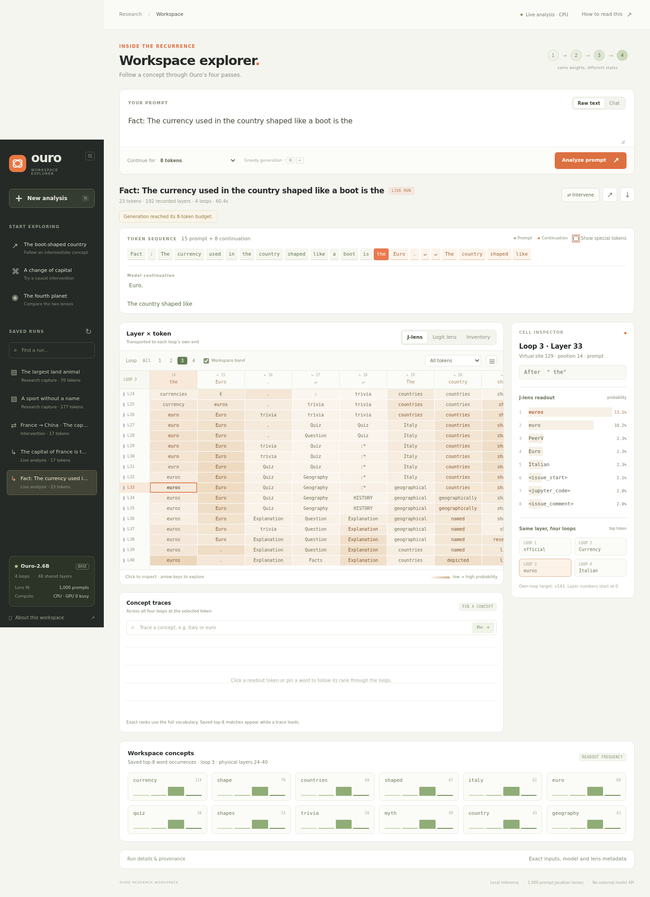

# Ouro J-lens

Jacobian lenses, workspace experiments, and an interactive results viewer for
**ByteDance/Ouro-2.6B**. The model repeats 48 transformer layers four times;
the adapter exposes all **192** distinct layer invocations. The completed
1,000-prompt fit contains **476 FP32 source-to-target matrices** targeting
the four loop ends at virtual sites 47, 95, 143 and 191.

This repository contains the implementation, frozen evaluation records,
reports, numerical checks, and five ready-to-browse viewer examples. Larger
fitted tensors and captured states are attached to the
[v0.1.0 release](https://github.com/ishwarbb/ouro-jlens/releases/tag/v0.1.0)
with SHA-256 checksums. Ouro model weights are downloaded separately from the
pinned upstream checkpoint.



## Open the recorded results

Only Python 3.10+ is needed. No model, GPU, Python packages, Node, or frontend
build step is required for the recorded viewer.

```bash
gh repo clone ishwarbb/ouro-jlens
cd ouro-jlens
python3 ouro_viewer.py --read-only --port 8769
```

Open **http://127.0.0.1:8769/**. The included currency, capital, intervention,
animal, and sport examples expose token sequences, J-lens/logit-lens grids,
loop comparisons, and saved concept traces or sparse inventories. Clicking a
cell opens its readout. JSON export and view links work in read-only mode.

If running remotely, execute the tunnel on your **local computer**, replacing
the host and SSH port with your own:

```bash
ssh -N -o ExitOnForwardFailure=yes -p SSH_PORT \
  -L 127.0.0.1:18769:127.0.0.1:8769 USER@HOST
```

Then open **http://127.0.0.1:18769/** locally. The server binds only to loopback.

## Live inference and interventions

The live environment was validated with Python 3.10, Transformers 4.57.6,
PyTorch 2.14.0, and NVIDIA L40S GPUs. `requirements.txt` pins the direct
dependencies; `environment-lock.txt` records the original full environment.
Install a PyTorch build appropriate for your platform if that build is not
available there.

```bash
python3 -m venv .venv
.venv/bin/pip install -r requirements.txt
.venv/bin/pip install --no-deps --no-build-isolation -e ./jacobian-lens
.venv/bin/python download_model.py
python3 download_artifacts.py --bundle lenses --bundle viewer
.venv/bin/python ouro_viewer.py --gpu 0 --port 8769
```

Use **Chat** for conversational instructions. **Raw text** continues an input
as ordinary text, which can produce repetition when used for questions.
Generation is greedy, allows 0–128 output tokens, and caps prompt plus output
at 512 tokens. Use the native chat template's system message and optional
assistant prefill when needed. The UI distinguishes capped output and thought
traces without a final answer.

Live runs capture all 192 sites. Pin concepts for full-vocabulary ranks;
compute a cell's positive sparse inventory; or transfer/remove a concept
direction and compare its continuation with the saved baseline. See
[the viewer guide](OURO_VIEWER.md) for controls and scoring semantics.

`--gpu 0` selects physical GPU 0; `--gpu 8` is also supported for the original
server. Automatic mode uses CPU when the selected GPU has less than 10 GiB
free. Add `--device cuda` to require the GPU or `--device cpu` to force CPU.
The model loads on first use and stays resident; model jobs are serialized.

## Results and limits

The latest validated study is [workspace-inventory-v2](results/workspace-inventory-v2/FINDINGS.md).
It completed 80 capture tasks, 188 inventory layers, and 64 ablation trials.
Independent verification checked **75,608 pursuit cells**, **244,088 coefficient
snapshots**, and **29,172 ablation bases**; all **64 native baseline logits**
matched exactly. Detailed outcomes and qualifications appear in the reports:

| Material | Location |
|---|---|
| Fit geometry and metadata | [JLENS_FAMILY.md](JLENS_FAMILY.md), [fit summary](results/jlens-family-1000/fit-summary.json) |
| Initial workspace protocols and results | [WORKSPACE_REPRODUCTION.md](WORKSPACE_REPRODUCTION.md), [report](results/workspace-full/REPORT.md) |
| Paper comparison and sensitivity audit | [WORKSPACE_AUDIT.md](WORKSPACE_AUDIT.md), [conclusions](results/workspace-audit/CONCLUSIONS.md) |
| Validated scoring, inventories and ablations | [WORKSPACE_INVENTORY.md](WORKSPACE_INVENTORY.md), [validation](results/workspace-inventory-v2/VALIDATION.md) |
| Strength and token-scoring follow-ups | [strength audit](results/workspace-strength-audit/REPORT.md), [token scoring](results/workspace-report-tokens/REPORT.md) |
| Viewer checks and screenshots | [verification](results/ouro-viewer/verification/browser-report.json) |

These are partial, qualitative reproduction results. They do **not** establish
full agreement with the paper: author-specific wrappers and filtering remain
unresolved, some controls differ, only two of eight inventory demonstrations
were captured, and one demonstration reaches its token cap inside a thought
block. Development prompts were reused; this is not an independent confirmation
study. Missing research loop-end cells and tokenization exclusions stay explicit.

## Artifacts and reproduction

`artifacts.json` lists release parts and the exact hash of every restored file.
For a private repository, authenticate with `gh auth login` before downloading.

```bash
# Download all fitted lenses, inventory tensors, example states and pilot lens.
python3 download_artifacts.py --bundle all

# Or use release parts already downloaded to another machine.
python3 download_artifacts.py --bundle lenses --from-dir /path/to/release-parts
```

The `lenses` bundle supplies the full 1,000-prompt family. `inventories` supplies
the frozen v2 tensors for independent reconstruction. `viewer` supplies residual
states for the five published examples; new runs create their own states.
`pilot` contains the historical four-site lens. Worker checkpoints, model
weights, personal interactive runs and the superseded smoke-fit tensors are
excluded. The downloader checks compressed and extracted bytes and preserves
different existing files.

To recreate the corpus or fit, use [WORKSPACE_REPRODUCTION.md](WORKSPACE_REPRODUCTION.md)
and [JLENS_FAMILY.md](JLENS_FAMILY.md). Choose a **new output directory** for a
fresh fit: committed manifests describe the original run and enforce its
provenance. The original full corpus selector is `ouro_full_fit.py --phase
prepare`; it excludes samples too short after tokenization. Earlier smoke
selection is documented separately. Model weights remain frozen during fitting.

## Tests

```bash
# No model or third-party Python packages needed:
python3 -m unittest -v test_ouro_viewer.py test_download_artifacts.py

# CPU numerical tests use the actual Ouro code with tiny random weights.
.venv/bin/python download_model.py --code-only
OMP_NUM_THREADS=2 .venv/bin/python -m unittest -v \
  test_ouro_lens test_ouro_family test_ouro_full_fit test_ouro_supervisor \
  test_workspace_analysis test_workspace_interventions test_workspace_audit \
  test_workspace_inventory test_ouro_viewer
```

Browser acceptance checks use Playwright in a separate environment; see
[OURO_VIEWER.md](OURO_VIEWER.md). The published checks exercised real model
generation, exact traces, sparse pursuit, cancellation, share/export persistence,
and a France→China intervention changing the first answer from Paris to Beijing.

## Provenance and attribution

This is a standalone snapshot of the Ouro J-lens work from
`ishwarbb/ouro-deception-eval`, including previously uncommitted implementation
and research artifacts. Frozen scientific records and source snapshots preserve
their original bytes; historical absolute paths identify the original host.
They are not required paths for a fresh clone. Packaging provenance is in
[provenance/](provenance/).

The reference `jacobian-lens` package and experiment prompts are vendored at
commit `98f59779f89e092c418615e5e67c52fa5fd590cd`, with their original Apache-2.0
license. Installation deliberately uses `--no-deps` because the upstream package
declares Transformers ≥5.5 while this Ouro adapter uses its model-independent
fitter with 4.57.6. See [THIRD_PARTY.md](THIRD_PARTY.md).

Scientific context: [Wang and Reid, arXiv:2609.01924v1](https://arxiv.org/html/2609.01924v1).
Viewer inspiration: [J-Lens Visualizer](https://j-lens-visualizer.vercel.app/),
[Neuronpedia](https://www.neuronpedia.org/qwen3.6-27b/jlens), and
[WeZZard/jlens-qwen36](https://github.com/WeZZard/jlens-qwen36).
