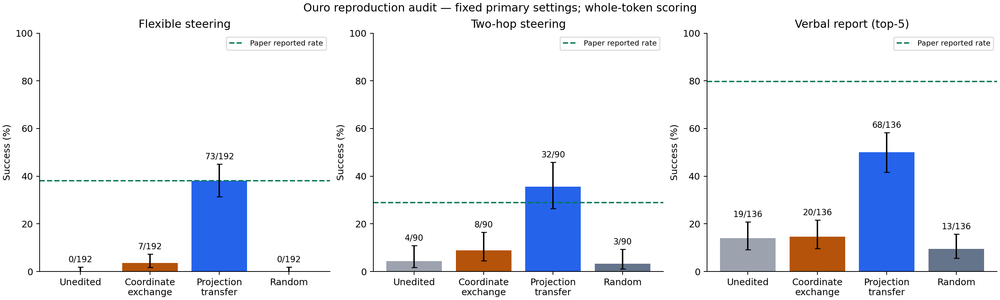
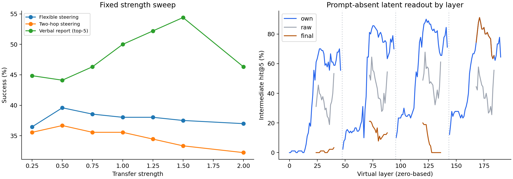

# Additional validation

1170 archived condition records have exactly equal whole-token scores at all four loop ends. This checks the unedited baseline, coordinate exchange, and projection transfer on every overlapping eligible primary trial.

## Verbal-report subsets

| Subset | Transfer success | Baseline success |
|---|---:|---:|
| all/top1 | 47/136 (34.6%) | 0/136 (0.0%) |
| all/top5 | 68/136 (50.0%) | 19/136 (14.0%) |
| outside_top10/top1 | 29/97 (29.9%) | 0/97 (0.0%) |
| outside_top10/top5 | 38/97 (39.2%) | 0/97 (0.0%) |
| valid_source/top1 | 31/36 (86.1%) | 0/36 (0.0%) |
| valid_source/top5 | 36/36 (100.0%) | 5/36 (13.9%) |
| valid_source_outside_top10/top1 | 20/25 (80.0%) | 0/25 (0.0%) |
| valid_source_outside_top10/top5 | 25/25 (100.0%) | 0/25 (0.0%) |

## All loop-subset contrasts against loops 2–4

Exploratory comparisons of the complete loop-subset grid. A benefit over each single loop does not prove every remaining loop is necessary.

| Condition minus loops 2–4 | Difference | 95% semantic-cluster interval |
|---|---:|---|
| loops_2 | -17.2 pp | [-25.0, -9.4] pp |
| loops_3 | -8.3 pp | [-14.6, -2.6] pp |
| loops_4 | -13.0 pp | [-21.4, -5.7] pp |
| loops_23 | +5.7 pp | [1.6, 10.9] pp |
| loops_24 | -7.3 pp | [-12.0, -3.6] pp |
| loops_34 | -5.2 pp | [-10.4, -1.0] pp |
| loops_1234 | -1.6 pp | [-4.2, 1.0] pp |

All subsets are descriptive post-run diagnostics. They do not replace the full attempted-trial primary denominator.

Error bars above are descriptive Wilson intervals; paired semantic-cluster intervals are in the main report. Paper and local denominators differ for verbal report.

